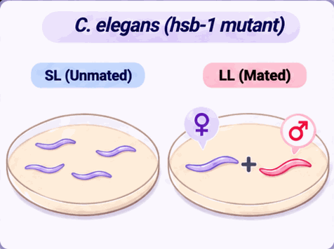

# Genome-wide NAME-seq Analysis Pipeline for 6mA Profiling in Caenorhabditis elegans

<p align="center">
  
</p>

This repository provides a revised computational workflow for genome-wide DNA N6-methyladenine (6mA) analysis in *Caenorhabditis elegans*.

The code is provided to support the reproducibility of the genome-wide 6mA analyses presented in the study.

## Reference genome

The *Caenorhabditis elegans* reference genome (WBcel235, NCBI RefSeq accession GCF_000002985.6) can be downloaded from:

https://www.ncbi.nlm.nih.gov/datasets/genome/GCF_000002985.6/

Download the genomic FASTA file, rename it to `GCF.fasta`, and place it in the `reference_genome/` directory before running the workflow.

## Usage

Run the following commands from the project directory.

**1. Build the Bowtie2 reference index**

```bash
python3 NAME-seq.py index \
  --index_name=GCF_full \
  --input_fasta=reference_genome/GCF.fasta
```

**2. NAME-seq analysis — Mated HSB1**

```bash
python3 NAME-seq.py quant \
  --index=GCF_full \
  --input_fasta=reference_genome/GCF.fasta \
  --outpath=output \
  --num_threads=8 \
  --date=713_mated_HSB1 \
  demo_data/mated_hsb_1_NAME/mated_hsb_1_NAME_CKDL250017079-1A_22V2TYLT4_L8_1.fq.gz \
  demo_data/mated_hsb_1_NAME/mated_hsb_1_NAME_CKDL250017079-1A_22V2TYLT4_L8_2.fq.gz
```

**3. NAME-seq analysis — Unmated HSB1**

```bash
python3 NAME-seq.py quant \
  --index=GCF_full \
  --input_fasta=reference_genome/GCF.fasta \
  --outpath=output \
  --num_threads=8 \
  --date=713_HSB1 \
  demo_data/hsb_1_NAME/hsb_1_NAME_S1_L008_R1_001.fastq.gz \
  demo_data/hsb_1_NAME/hsb_1_NAME_S1_L008_R2_001.fastq.gz
```

Replace the example FASTQ paths with the locations of your own sequencing files. The workflow requires paired-end FASTQ files and the corresponding reference genome.

## Data availability

Raw FASTQ files and processed data have been deposited in NCBI GEO under accession number GSE354517.

https://www.ncbi.nlm.nih.gov/geo/query/acc.cgi?acc=GSE354517

## Code availability

Zenodo DOI: https://doi.org/10.5281/zenodo.24075556

## Acknowledgments

This workflow was adapted from the original NAME-seq computational pipeline:

https://github.com/TaoLabBCM/NAME-seq

## Contributors

Yi-Shan Lan, Dr. Chung-Yi Liang, Dr. Ao-Lin Hsu
